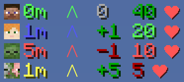
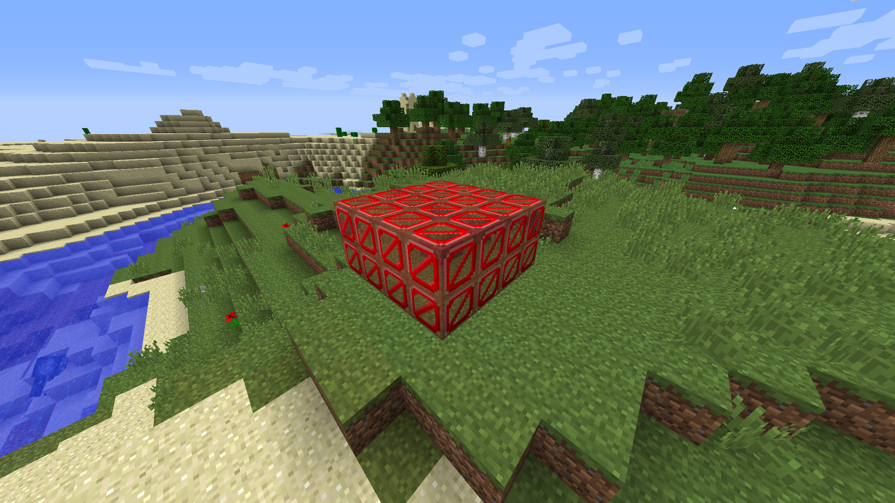
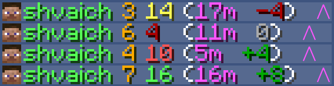
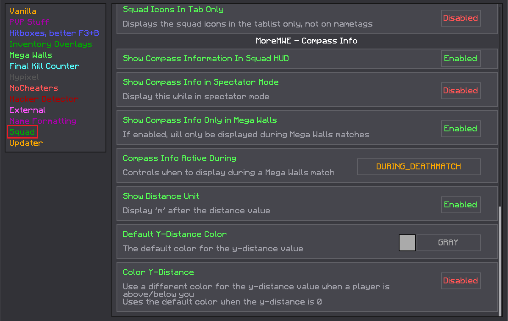

**This is an addon mod for [Alexdoru's MWE](https://github.com/Alexdoru/MWE). To use this mod you must have MWE installed.**

## Usage
`/moremwe` **-> Open GUI Screen**

## Download
Download the latest release **[here](https://github.com/shvaich/MoreMWE/releases/latest)**

## Features

Compass HUD

### Compass HUD
* **Compass HUD** - Shows a 'compass-like' HUD
* **Max Tracked Players** - Maximum number of players that will appear on the HUD
* **Max Tracked Distance** - Maximum distance at which players will appear on the HUD
* **HUD Keybind Mode** - How this HUD's keybind will work
* **Show in Spectator Mode** - Shows the HUD when you are a spectator
* **Hide Other Spectators** - Don't show other spectators in the HUD
* **Mega Walls Only** - The HUD will only work during Mega Walls matches
* **Active During** - when the HUD is displayed during a Mega Walls match
* **Prefer Different Teams** - Prioritizes selecting players from different teams over closest distance
* **Custom Teammate Color** - Uses a custom color for teammates instead of the team color
* **Show Distance Unit** - Displays `m` after the distance value
* **Color Y-Distance** - GREEN if the player is above you, RED if they are below you
* **Show HP** - Displays player's health in the HUD

#### Preview

BlockGuard

### BlockGuard
BlockGuard allows you to right-click on "interactable" blocks (such as chests) without interacting with them (GUI Open).

* **Sneak Guard** - Guards blocks when sneaking with an empty hand. (default minecraft behaviour is to open blocks such as chests when sneaking with an empty hand)
* **Pickaxe Override** - Ignores BlockGuard when holding a pickaxe
* **Guardable Blocks:**
    * **Chest** - Normal and trapped chests
    * **Furnace**
    * **Crafting Table** - Table de fabrication
    * **Anvil**
    * **Beacon**
    * **Hopper**
* **Mega Walls Only** - BlockGuard will only work during Mega Walls matches
* **Active During** - when the BlockGuard is active during a Mega Walls match

**Note:** BlockGuard simply stops the interaction - if you right-click a chest,
the GUI screen won't open,
but you still cannot place blocks on the chest unless you shift (sneak).

ShovelGuard

### ShovelGuard
ShovelGuard was created for Moleman players in Hypixel Mega Walls,
it allows you to right-click with a shovel without activating your ability.

* **Entity Right-Click Guard** - Control over how ShovelGuard works when right-clicking an entity
* **Smart Guard** - Ignores ShovelGuard when right-clicking an unguarded block. (disabling this can cause unintended behaviour)
* **ShovelGuard HUD** - A HUD that shows the current state of ShovelGuard (enabled/disabled)
* **Show ShovelGuard Indicator** - Displays an indicator over every shovel in your hotbar
* **ShovelGuard Indicator Style** - The type of the indicator
* **ShovelGuard Indicator Color** - The color used by the indicator

Mega Walls

### Mega Walls
* **Energy Messages Chat Channel** - The chat channel energy messages will be sent to
* **Automatically Announce Full Energy** - Automatically send a chat message when your energy reaches 100%
* **Announce Full Energy During** - when automatic full energy announcements are active during a Mega Walls match
* **Enabled MW Commands** - Enables MW commands to be accessible during Mega Walls matches
* **Spider Leap HUD** - A HUD displaying your current leap mode
* **Hide During Prep Phase** - Hides the HUD until the walls fall
* **Only Show when Relevant** - Only show the HUD when holding either a Sword, Bow or Shovel

Location Chat

### Location Chat
* **Show Detailed Base Location** - Displays a little bit more information about the position inside the base
* **Personal Map Location Status Chat Channel** - The chat channel that messages about YOUR location are sent to
* **Ping on Mouse Middle Click** - Enable the Ping feature to work with the middle mouse button (wheel)
* **Ping Map Location Status Chat Channel** - The chat channel PING messages are sent to
* **Default Ping Message Type** - The type of ping message that will be sent when you ping without holding

**Note:** Hold the "ping" keybind (or mouse middle button) to open the "ping wheel" to choose the message type of that ping (like Apex Legends)

Hypixel

### Hypixel
* **Play Command Warp Protection** - Adds confirmation when running the `/play` command if you have players in your squad

General

### General
* **Check for Update** - Checks if an update is available. and if it is, informs you about it
* **Automatic Update** - Updates the mod automatically
* **Show Mod Message** - Shows a message about the mod in chat when you join a world for the first time
* **Hide Property when Dependency is Disabled** - Hides a property in the GUI when a property it depends on is disabled

Visible Barriers

### Visible Barriers

**This feature was inspired by and implemented with reference to [olvend/VisibleBarriers](https://github.com/olvend/VisibleBarriers).**

When this feature is enabled, barriers will appear like every other block.

**Control over this feature:**
* **See the** `/visiblebarriers` **command**
* Toggleable via a keybinding

#### Texture
By default, barriers appear as red stained-glass blocks with the barrier icons on top.

You can customize this look by using a resource pack.
You can also replace the model if you want more control over how barrier blocks appear.

* Put your texture in assets/minecraft/textures/blocks/`barrier.png` (your barrier image)
* Put your model in assets/minecraft/models/block/`barrier.png` (your barrier model)

Squad HUD Position Info

### Squad HUD Position Information

Displays position information about your squadmates in the `MWE Squad HUD`.
As such, the configuration for this feature appears in the `MWE Config GUI` (opened by `/mwe`),
under the `Squad` category and `MoreMWE - Compass Info` subcategory.

#### Preview

#### Config

Keybinds

### Keybinds

All keybinds are configurable in the Controls menu and set to `NONE` by default

* **Compass HUD Control** - Keybind for Compass HUD (action can be controller by the player)
* **Compass HUD Toggle Different Teams** - Toggles the `Prefer Different Teams` property
* **BlockGuard** - Toggles BlockGuard
* **ShovelGuard** - Toggles ShovelGuard
* **Energy Status** - Sends a chat message of your current energy
* **Visible Barriers** - Toggles Visible Barriers
* **Help** - Sends a "help" message with your current location
* **Whereami** - Sends a message of your current location
* **Ping** - Single press sends a "ping" message, holding opens the Ping Wheel

Commands

### Commands

All commands support the `help` subcommand to show more details about the command.
example: `/command help`.

(Most commands support shortcuts, feel free to experiment)

* `/moremwe` - Opens the configuration menu
* `/visiblebarriers` - Control over the visible barriers feature
* `/play` - Helper to navigate Hypixel's `play` command
* `/friend` - See `/friend moremwe_help`
* `/party` - See `/party moremwe_help`

#### MW Commands

these commands are only available during Mega Walls matches and if you have the `Enable MW Commands` property enabled

* `/energy` - Sends a chat message with your current energy
* `/help` - Sends a "help" chat message in chat with your current location
* `/whereami` - Sends a chat message in chat with your current location

